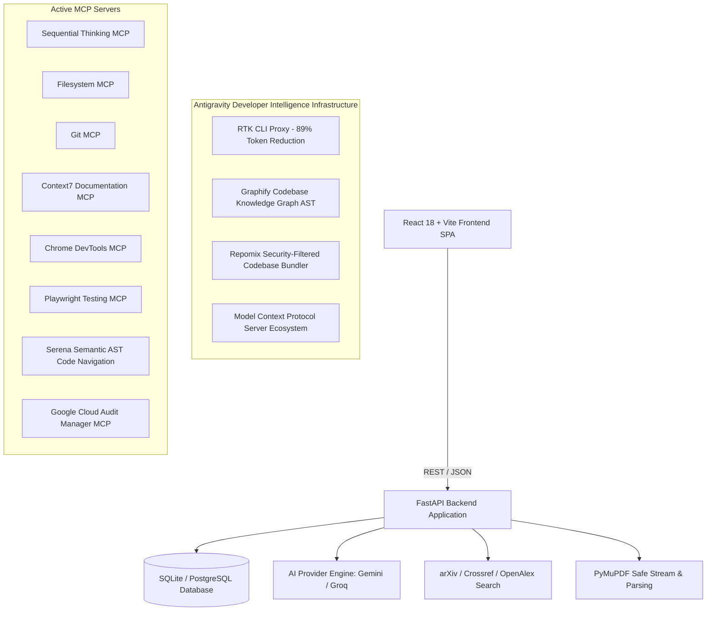

# System Architecture: ROSS-SEARCH & Development Ecosystem



## 1. Directory Structure
```
e:\Thesis\
├── .agents/                    # Antigravity agent configuration, MCP & rules
│   ├── mcp_config.json         # Workspace MCP Server configuration
│   ├── rules/                  # Role-based agent behavior & tool routing rules
│   └── workflows/              # Graphify & development workflows
├── backend/                    # FastAPI Backend
│   ├── alembic/                # Database migrations
│   ├── app/
│   │   ├── api/routes/         # Auth, Students, Supervisors, Teams, Admin, Research
│   │   ├── core/               # Config, Security, JWT, Dependencies
│   │   ├── database/           # Connection, Session, Base, Seeders
│   │   ├── models/             # SQLAlchemy ORM Models
│   │   ├── schemas/            # Pydantic v2 validation models
│   │   └── services/           # Academic search, PDF processor, AI providers
│   └── test_suite.py           # Comprehensive integration verification
├── src/                        # React Frontend
│   ├── components/             # Reusable UI components & layouts
│   ├── context/                # AuthContext, NotificationContext
│   ├── pages/                  # Portal pages (Student, Supervisor, Admin, Research)
│   └── services/               # API clients (api.js, module1Service, module2Service)
├── graphify-out/               # Codebase Knowledge Graph (graph.json, graph.html)
└── repomix.config.json         # Codebase context packager configuration
```

## 2. Data Flow & Security Boundaries
- **Authentication:** Stateless JWT bearer tokens with expiration and DB token revocation checks.
- **SSRF Hardening:** In `download_pdf_safely()`, strict URL validation prevents access to loopback, private IPv4 (RFC 1918), link-local, and AWS/cloud metadata endpoints (169.254.169.254).
- **Public vs Protected:** Public endpoints allow research paper exploration, topic similarity test, and AI research chat without forced login. Administrative actions enforce strict `require_admin` dependency.
