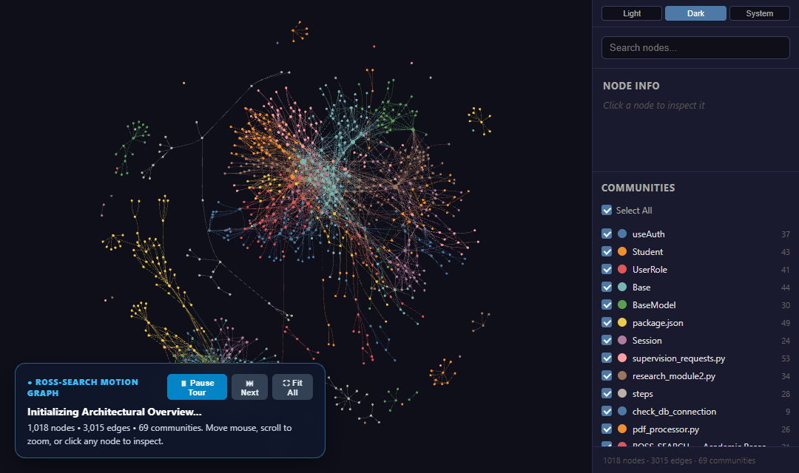

# ROSS-SEARCH — Academic Research Intelligence Platform

[](https://ross-search.onrender.com)
[](https://ross-search-api.onrender.com/docs)
[](https://ross-search-api.onrender.com/api/health)

**A Research-Oriented Smart Search and Academic Intelligence Platform for FYP and Thesis Development.**
**University:** Daffodil International University (DIU)
**Live Production URL:** [https://ross-search.onrender.com](https://ross-search.onrender.com)
**Live API Documentation:** [https://ross-search-api.onrender.com/docs](https://ross-search-api.onrender.com/docs)

---

## 🚀 Overview

ROSS-SEARCH is a comprehensive Academic Research Intelligence Platform built for Daffodil International University (DIU) students preparing Final Year Projects (FYP) and Master's Theses.

**Technology Stack:** React 18 + Vite + Tailwind CSS + FastAPI + SQLite + Lucide Icons + React Router v6

The platform provides end-to-end research support: from supervisor discovery and team formation, to AI-powered academic paper analysis, topic similarity detection, and a departmental shared knowledge repository.

---

## 👥 Project Team

| Contributor | Student ID | GitHub Profile |
|---|---|---|
| **Md. Robayet Islam** | 232-35-809 | [](https://github.com/KaloNakre) |
| **Riya Saha** | 232-35-715 | [](https://github.com/suronjonaSahA) |
| **Tamim Hasan Sami** | 232-35-313 | [](https://github.com/TamimWhos) |

> **Repository:** Write and commit access maintained by Md. Robayet Islam. All contributors are recognized for their platform development responsibilities.

---

## 🎨 Design & Privacy Principles

1. **Branding:** Uses `ROSS-SEARCH` as the unified platform name throughout.
2. **Official Palette:** DIU professional colors (`#094B8A` primary blue, `#008751` green, `#0A1E3F` deep navy, `#EBF4FC` background).
3. **Official Imagery:** High-resolution DIU Ashulia campus building and official logos.
4. **Privacy First:**
   - No real or fake generated human portraits.
   - Neutral placeholders (`Dr. Full Name`, `Student Candidate`) used throughout.
   - Profile image upload with instant preview, replace, and remove.
   - Actionable empty states throughout.

---

## 🧭 Platform Pages & Routes

### Student Portal

| # | Page | Route | Scope |
|---|---|---|---|
| 1 | **Home / Landing Page** | `/` | Public platform showcase |
| 2 | **Student Registration** | `/register` | Account creation with research interest selection |
| 3 | **Login** | `/login` | Multi-role authentication |
| 4 | **Student Dashboard** | `/student/dashboard` | Overview metrics and quick actions |
| 5 | **Student Profile** | `/student/profile` | Academic profile, interests, and project status |
| 6 | **Edit Student Profile** | `/student/profile/edit` | Profile management with research domain selection |
| 7 | **Research Interests** | `/student/research-interests` | Interest taxonomy management |
| 8 | **Find Supervisor** | `/supervisors` | Supervisor discovery with domain and department filters |
| 9 | **Supervisor Profile** | `/supervisors/:id` | Credentials, expertise, and supervision request |
| 10 | **Edit Supervisor Profile** | `/supervisor/profile/edit` | Supervisor profile and expertise management |
| 11 | **Search Students by Section** | `/students/section` | Peer discovery within academic sections |
| 12 | **Team Search & Formation** | `/teams/search` | Browse teams and explore open positions |
| 13 | **Create Team** | `/teams/create` | Team creation with domain selection |
| 14 | **Team Details** | `/teams/:id` | Roster management and supervisor assignment |
| 15 | **My Teams** | `/teams/my-teams` | Personal team management |

### Academic Research Features

| # | Page | Route | Scope |
|---|---|---|---|
| 16 | **Research Discovery** | `/research/discovery` | Federated paper search across arXiv, Crossref, OpenAlex |
| 17 | **AI Research Breakdown** | `/research/summarizer` | Multi-model AI analysis of research papers |
| 18 | **Public Research Assistant** | `/research/chat` | AI research Q&A — no login required |
| 19 | **Topic Similarity** | `/research/topics` | NLP duplicate thesis topic detection |
| 20 | **Shared Knowledge Repository** | `/research/shared-knowledge` | Departmental AI-analyzed paper database |

### Administration

| # | Page | Route | Scope |
|---|---|---|---|
| 21 | **Admin Dashboard** | `/admin/dashboard` | Platform analytics overview |
| 22 | **Manage Students** | `/admin/users` | Student directory and account management |
| 23 | **Manage Supervisors** | `/admin/supervisors` | Faculty directory and capacity management |
| 24 | **Role Management (RBAC)** | `/admin/roles` | Role permissions and access control |
| 25 | **Database Studio** | `/admin/database` | Live database exploration with cascade viewer |

---

## ⚡ Quick Start

```bash
# Install frontend dependencies
npm install

# Start development server
npm run dev

# Build for production
npm run build

# Start backend API
cd backend && uvicorn app.main:app --reload
```

> **Role Switching:** Use the **Switch View** pill in the top navigation to toggle between `Student`, `Supervisor`, and `Admin` perspectives.

---

## 🔬 Core Platform Features

### Academic Research Discovery
- Federated search across arXiv, Crossref, and OpenAlex open-access repositories
- Filter by domain, year range, and author
- Personal reading library with BibTeX export
- DIU FYP/Thesis project archive search

### AI Research Breakdown
- Multi-model analysis engine: Google Gemini 1.5 Flash/Pro, Groq Llama 3.3, PyMuPDF Neural NLP (offline)
- Strict academic honesty enforcement — unstated metrics flagged explicitly
- Supports PDF upload, arXiv URL, or direct text input
- Results include: problem statement, objectives, methodology, datasets, results, limitations, research gaps, and future directions

### Research Topic Intelligence
- NLP-powered topic similarity detection against DIU archive and active cohort
- Duplicate rejection threshold (>70% similarity)
- Novel thesis topic suggestions with methodology, datasets, and novelty angle

### Supervisor Discovery & Management
- Supervisor directory with research expertise, availability, and slot tracking
- Supervision request workflow with accept/reject pipeline
- Research opportunity publishing with deadline and quota management

### Team Formation
- Intra-section peer discovery
- Team creation with supervisor nomination
- Member management and join request approval

### Browser Extension (Manifest V3)
- Domain security audit: HTTPS/TLS, security headers, risk scoring
- 12-section technical security analysis report
- Real-time domain intelligence — no login required

### AI Research Assistant (Public)
- Free access to AI research Q&A without mandatory login
- Rate-limited for responsible use (100 requests/min)
- Multi-model routing for optimal response quality

---

## 📂 Source Code Structure

```
ROSS-SEARCH/
├── src/
│   ├── components/          # Shared UI components (Sidebar, Topbar, Layout)
│   ├── context/             # Authentication & JWT context
│   ├── data/                # Research domain taxonomy and mock data
│   ├── pages/
│   │   ├── admin/           # Administration pages
│   │   ├── research/        # Academic research features
│   │   ├── student/         # Student-specific pages
│   │   └── supervisor/      # Supervisor management pages
│   └── services/            # API service clients
├── backend/
│   ├── app/
│   │   ├── api/routes/      # FastAPI REST endpoints
│   │   ├── models/          # SQLAlchemy database models
│   │   ├── schemas/         # Pydantic validation schemas
│   │   └── services/        # AI, PDF processing, academic search engines
│   ├── test_suite.py        # Core system verification (3 iterations × 9 steps)
│   └── test_module2_master.py  # Research intelligence test suite (9 tests)
└── extension/               # Chromium Manifest V3 browser extension
```

---

## 🧠 Interactive Motion Knowledge Graph (Graphify)

[](https://ross-search.onrender.com/graph.html)

> **🚀 [Launch Live Interactive Motion HTML Graph (Zoom, Pan, Drag & Click Nodes)](https://ross-search.onrender.com/graph.html)**  
> *Auto-tours key modules (`useAuth`, `ai_provider.py`, `module3_ai.py`, `research_module2.py`) with motion-zoom spotlights. Move your cursor, scroll to zoom, or click any node to pause and explore freely (1,018 nodes • 3,015 edges • 69 communities).*

---

## 🌐 Live Presentation Links — Module 2 & Module 3 (By Team Member)

* **Live Web Portal:** https://ross-search.onrender.com
* **Live Backend API & Swagger Docs:** https://ross-search-api.onrender.com/docs
* **Live System Health:** https://ross-search-api.onrender.com/api/health

### Quick Demo Login Credentials
| Role | Login Page | Email / ID | Password |
|---|---|---|---|
| **Student** | https://ross-search.onrender.com/#/login | `arif.hossain@diu.edu.bd` | `Diu@12345` |
| **Supervisor** | https://ross-search.onrender.com/#/login | `dr.syed.tareq@diu.edu.bd` | `Diu@12345` |
| **Admin** | https://ross-search.onrender.com/#/admin/login | ID: `ADM-101` / `admin@diu.edu.bd` | `Admin@12345` |

### 1. Riya Saha (ID: `232-35-715`)
| Module | Feature | Frontend Live Page | Frontend Code (`.jsx`) | Backend Code (`.py`) |
|---|---|---|---|---|
| **Module 2.1** | Research Domain & Paper Discovery | [Open Live Page](https://ross-search.onrender.com/#/research/discovery) | [ResearchDiscoveryPage.jsx](https://github.com/KaloNakre/ROSS-SEARCH/blob/main/src/pages/research/ResearchDiscoveryPage.jsx) | [research_module2.py#L65-L120](https://github.com/KaloNakre/ROSS-SEARCH/blob/main/backend/app/api/routes/research_module2.py#L65-L120) |
| **Module 3.2** | Student Submissions & Milestones | [Open Live Page](https://ross-search.onrender.com/#/project/submissions) | [StudentSubmissionsPage.jsx](https://github.com/KaloNakre/ROSS-SEARCH/blob/main/src/pages/module3/StudentSubmissionsPage.jsx) | [module3.py#L245-L296](https://github.com/KaloNakre/ROSS-SEARCH/blob/main/backend/app/api/routes/module3.py#L245-L296) • [models/module3.py](https://github.com/KaloNakre/ROSS-SEARCH/blob/main/backend/app/models/module3.py) |
| **Module 3.2** | Supervisor Review & Feedback Portal | [Open Live Page](https://ross-search.onrender.com/#/supervisor/submissions) | [SupervisorReviewPage.jsx](https://github.com/KaloNakre/ROSS-SEARCH/blob/main/src/pages/module3/SupervisorReviewPage.jsx) | [module3.py#L299-L339](https://github.com/KaloNakre/ROSS-SEARCH/blob/main/backend/app/api/routes/module3.py#L299-L339) • [milestones#L343-L443](https://github.com/KaloNakre/ROSS-SEARCH/blob/main/backend/app/api/routes/module3.py#L343-L443) |

### 2. Robayet Islam (ID: `232-35-809`)
| Module | Feature | Frontend Live Page | Frontend Code (`.jsx`) | Backend Code (`.py`) |
|---|---|---|---|---|
| **Module 2.2** | AI Paper Summarizer (English + বাংলা) | [Open Live Page](https://ross-search.onrender.com/#/research/summarizer) | [PaperSummarizerPage.jsx](https://github.com/KaloNakre/ROSS-SEARCH/blob/main/src/pages/research/PaperSummarizerPage.jsx) | [summarize-pdf#L313-L384](https://github.com/KaloNakre/ROSS-SEARCH/blob/main/backend/app/api/routes/research_module2.py#L313-L384) • [ai_provider.py](https://github.com/KaloNakre/ROSS-SEARCH/blob/main/backend/app/services/ai_provider.py) • [pdf_processor.py](https://github.com/KaloNakre/ROSS-SEARCH/blob/main/backend/app/services/pdf_processor.py) |
| **Module 3.1** | Official DIU Templates Repository | [Open Live Page](https://ross-search.onrender.com/#/proposal/templates) | [TemplatesRepositoryPage.jsx](https://github.com/KaloNakre/ROSS-SEARCH/blob/main/src/pages/module3/TemplatesRepositoryPage.jsx) | [module3.py#L52-L131](https://github.com/KaloNakre/ROSS-SEARCH/blob/main/backend/app/api/routes/module3.py#L52-L131) |
| **Module 3.1** | AI Proposal Structure & Grammar Checker | [Open Live Page](https://ross-search.onrender.com/#/proposal/check) | [ProposalCheckerPage.jsx](https://github.com/KaloNakre/ROSS-SEARCH/blob/main/src/pages/module3/ProposalCheckerPage.jsx) | [module3.py#L138-L196](https://github.com/KaloNakre/ROSS-SEARCH/blob/main/backend/app/api/routes/module3.py#L138-L196) • [module3_ai.py#L5-L140](https://github.com/KaloNakre/ROSS-SEARCH/blob/main/backend/app/services/module3_ai.py#L5-L140) |
| **Module 3.3** | AI Practice Viva Defense Simulator | [Open Live Page](https://ross-search.onrender.com/#/student/viva-prep) | [VivaPracticePage.jsx](https://github.com/KaloNakre/ROSS-SEARCH/blob/main/src/pages/module3/VivaPracticePage.jsx) | [module3.py#L451-L507](https://github.com/KaloNakre/ROSS-SEARCH/blob/main/backend/app/api/routes/module3.py#L451-L507) • [module3_ai.py#L143-L247](https://github.com/KaloNakre/ROSS-SEARCH/blob/main/backend/app/services/module3_ai.py#L143-L247) |

### 3. Tamim Hasan Sami (ID: `232-35-313`)
| Module | Feature | Frontend Live Page | Frontend Code (`.jsx`) | Backend Code (`.py`) |
|---|---|---|---|---|
| **Module 2.3** | Topic Similarity & Duplicate Detection | [Open Live Page](https://ross-search.onrender.com/#/research/similarity) | [TopicSimilarityPage.jsx](https://github.com/KaloNakre/ROSS-SEARCH/blob/main/src/pages/research/TopicSimilarityPage.jsx) | [research_module2.py#L439-L515](https://github.com/KaloNakre/ROSS-SEARCH/blob/main/backend/app/api/routes/research_module2.py#L439-L515) |
| **Module 2.4** | Shared Paper Knowledge Repository | [Open Live Page](https://ross-search.onrender.com/#/research/shared-knowledge) | [SharedKnowledgeRepositoryPage.jsx](https://github.com/KaloNakre/ROSS-SEARCH/blob/main/src/pages/research/SharedKnowledgeRepositoryPage.jsx) | [research_module2.py#L603-L685](https://github.com/KaloNakre/ROSS-SEARCH/blob/main/backend/app/api/routes/research_module2.py#L603-L685) |
| **Module 3.4** | Departmental FYP Analytics (Admin) | [Open Live Page](https://ross-search.onrender.com/#/admin/analytics) | [DepartmentalAnalyticsPage.jsx](https://github.com/KaloNakre/ROSS-SEARCH/blob/main/src/pages/module3/DepartmentalAnalyticsPage.jsx) | [module3.py#L515-L611](https://github.com/KaloNakre/ROSS-SEARCH/blob/main/backend/app/api/routes/module3.py#L515-L611) • [schemas/module3.py](https://github.com/KaloNakre/ROSS-SEARCH/blob/main/backend/app/schemas/module3.py) |

---

## 🔧 Backend Source Code & Endpoints (Module 2 & Module 3)

| Endpoint | Method | Direct Backend Source Code (`.py`) | Description |
|---|---|---|---|
| `/api/research/academic-papers` | GET | [research_module2.py#L65](https://github.com/KaloNakre/ROSS-SEARCH/blob/main/backend/app/api/routes/research_module2.py#L65) | Federated paper discovery with domain/year/author filters |
| `/api/research/summarize-pdf` | POST | [research_module2.py#L313](https://github.com/KaloNakre/ROSS-SEARCH/blob/main/backend/app/api/routes/research_module2.py#L313) • [ai_provider.py](https://github.com/KaloNakre/ROSS-SEARCH/blob/main/backend/app/services/ai_provider.py) | Multi-model AI Research Breakdown (English + বাংলা) |
| `/api/research/check-similarity` | POST | [research_module2.py#L439](https://github.com/KaloNakre/ROSS-SEARCH/blob/main/backend/app/api/routes/research_module2.py#L439) | Topic duplicate detection via TF-IDF Cosine Similarity |
| `/api/research/shared-knowledge` | GET/POST | [research_module2.py#L603](https://github.com/KaloNakre/ROSS-SEARCH/blob/main/backend/app/api/routes/research_module2.py#L603) | Shared departmental paper summaries & research gaps |
| `/api/research/library` & `/library/save` | GET/POST | [research_module2.py#L691](https://github.com/KaloNakre/ROSS-SEARCH/blob/main/backend/app/api/routes/research_module2.py#L691) | Personal reading library management |
| `/api/module3/templates` | GET/POST | [module3.py#L52](https://github.com/KaloNakre/ROSS-SEARCH/blob/main/backend/app/api/routes/module3.py#L52) | Official DIU PPTX/DOCX/PDF templates repository |
| `/api/module3/check-document` | POST | [module3.py#L138](https://github.com/KaloNakre/ROSS-SEARCH/blob/main/backend/app/api/routes/module3.py#L138) • [module3_ai.py](https://github.com/KaloNakre/ROSS-SEARCH/blob/main/backend/app/services/module3_ai.py) | AI proposal structure, missing sections & grammar checker |
| `/api/module3/submissions` & `/{id}/review` | GET/POST/PUT | [module3.py#L204](https://github.com/KaloNakre/ROSS-SEARCH/blob/main/backend/app/api/routes/module3.py#L204) | Versioned project submissions & supervisor review |
| `/api/module3/milestones` | GET/POST/PUT | [module3.py#L343](https://github.com/KaloNakre/ROSS-SEARCH/blob/main/backend/app/api/routes/module3.py#L343) | 5-phase FYP milestone & progress tracking |
| `/api/module3/viva/generate` | POST | [module3.py#L451](https://github.com/KaloNakre/ROSS-SEARCH/blob/main/backend/app/api/routes/module3.py#L451) | AI practice viva defense question generator |
| `/api/module3/analytics/departmental` | GET | [module3.py#L515](https://github.com/KaloNakre/ROSS-SEARCH/blob/main/backend/app/api/routes/module3.py#L515) | Departmental domain distribution & supervisor workload |

> **Academic Integrity:** All academic papers sourced from authentic open-access repositories (arXiv, Crossref, OpenAlex). Zero fabricated citations or AI-generated research results.
